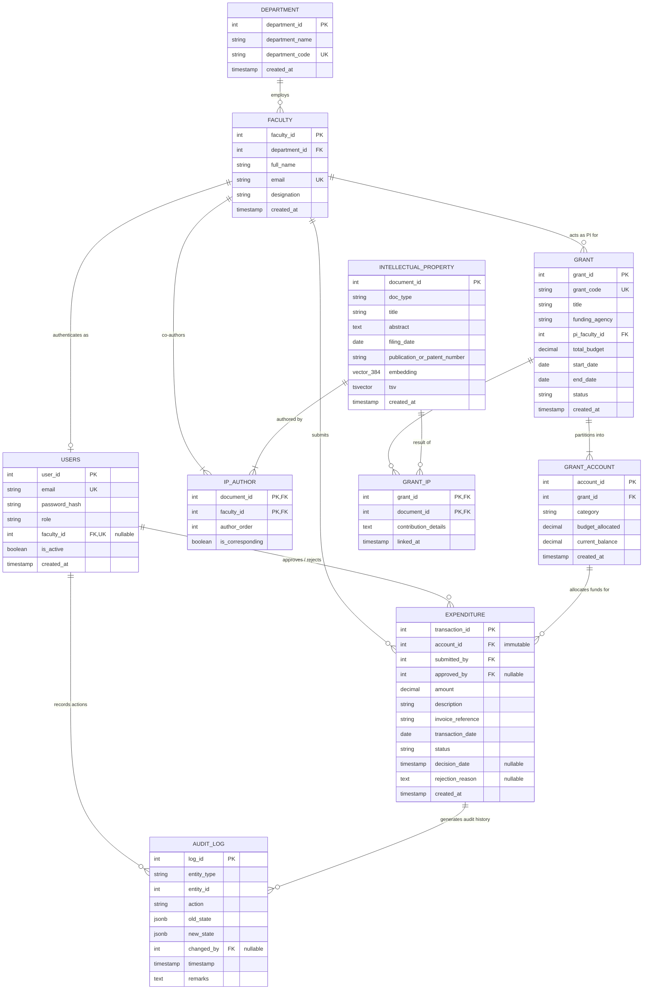

# Entity-Relationship (ER) Architecture

## 1. Conceptual Overview & Design Improvements

Our initial draft ER diagram captured the foundational core of university research grant administration (Department, Faculty, Grant, Grant Account, Expenditure, Intellectual Property). To support real-world university workflows and the project specifications, we introduced eight key improvements:

1. **Authentication Layer (`USERS`)**: Added a dedicated `USERS` table storing credentials, password hashes, and roles (`ADMIN` or `FACULTY`). For faculty accounts, `faculty_id` has a unique foreign key with `ON DELETE RESTRICT` (faculty profiles cannot be deleted while a user account exists, and each faculty member can have at most one user account).
2. **Many-to-Many Authorship (`IP_AUTHOR`)**: Converted the single-author link into an associative entity `IP_AUTHOR` supporting multiple faculty co-authors with explicit `author_order` and `is_corresponding` attributes.
3. **Many-to-Many Grant Association (`GRANT_IP`)**: Research disclosures often receive funding from multiple grants, and a large grant produces multiple disclosures. Created an associative entity `GRANT_IP` to model this relationship.
4. **Grant Account Allocation (`budget_allocated`)**: Added `budget_allocated` to `GRANT_ACCOUNT` alongside `current_balance`. The database automatically initializes `current_balance = budget_allocated` on creation, updates it when budget allocations shift, and blocks direct external updates to the balance column.
5. **Expenditure State Consistency (`EXPENDITURE`)**: Added `submitted_by` (linking to submitting `FACULTY`), `approved_by` (linking to approving `USERS` with `ON DELETE RESTRICT`), and explicit CHECK constraints tying status to audit columns:
   - When `PENDING`, `approved_by` and `decision_date` must be NULL.
   - When `APPROVED`, `approved_by` and `decision_date` must NOT be NULL.
   - When `REJECTED`, `decision_date` and `rejection_reason` must NOT be NULL.
6. **Grant Lifecycle Governance (`GRANT`)**: Added `start_date`, `end_date`, and lifecycle `status` (`ACTIVE`, `CLOSED`, `SUSPENDED`) to ensure expenditures can only be billed against active grants within their validity dates.
7. **Semantic Vector & Full-Text Capabilities (`INTELLECTUAL_PROPERTY`)**: Added `abstract` text, `doc_type` (`PATENT`, `PAPER`, `DRAFT_DISCLOSURE`), `filing_date`, dense `embedding` (`vector(384)`), and a `tsvector` column (`tsv`) for text search.
8. **Append-Only Audit Trail (`AUDIT_LOG`)**: Added an audit table populated by database triggers on expenditure status transitions. The table includes a trigger that blocks all `UPDATE` and `DELETE` operations so history cannot be altered or removed.

---

## 2. Final Entity-Relationship Diagram

---

## 3. Relationship Specifications, Cardinality & Participation

The table below describes every relationship in the schema, including mapping cardinality, participation constraints, and operational meaning:

| Relationship Name | Participating Entities | Cardinality | Participation | Description |
|---|---|:---:|:---:|---|
| **Department Employs Faculty** | `DEPARTMENT` to `FACULTY` | 1 : N | Total (Faculty) / Partial (Department) | Every faculty member must belong to exactly one department (`department_id` NOT NULL). A department can employ zero or more faculty members. |
| **Faculty User Authentication** | `FACULTY` to `USERS` | 1 : 1 (or 0..1) | Partial (Faculty) / Partial (Users) | A faculty member may have at most one user account (`faculty_id` UNIQUE). Admin user accounts have a `NULL` `faculty_id`. Faculty accounts link to `faculty(faculty_id)` with `ON DELETE RESTRICT`. |
| **Faculty PI for Grant** | `FACULTY` to `GRANT` | 1 : N | Partial (Faculty) / Total (Grant) | Every grant must have exactly one Principal Investigator (`pi_faculty_id` NOT NULL). A faculty member can serve as PI on zero or multiple grants. |
| **Grant Partitioned into Accounts** | `GRANT` to `GRANT_ACCOUNT` | 1 : N | Total (Account) / Total (Grant) | Every grant account belongs to exactly one grant (`grant_id` NOT NULL). A grant is partitioned into one or more category accounts. |
| **Account Allocates for Expenditure** | `GRANT_ACCOUNT` to `EXPENDITURE` | 1 : N | Total (Expenditure) / Partial (Account) | Every expenditure is billed against one specific grant account. Once submitted, `account_id` cannot be changed. |
| **Faculty Submits Expenditure** | `FACULTY` to `EXPENDITURE` | 1 : N | Total (Expenditure) / Partial (Faculty) | Every expenditure must be submitted by a verified faculty member (`submitted_by` NOT NULL). |
| **User Approves Expenditure** | `USERS` to `EXPENDITURE` | 1 : N | Partial (Expenditure) / Partial (Users) | When an expenditure is approved or rejected, `approved_by` records the administrator's `user_id` with `ON DELETE RESTRICT`. Pending expenditures have `NULL` `approved_by`. |
| **Faculty Co-Authors IP** | `FACULTY` to `INTELLECTUAL_PROPERTY` | M : N (via `IP_AUTHOR`) | Partial (Faculty) / Total (IP) | An intellectual property record must have at least one co-author (`IP_AUTHOR`). A faculty member can co-author zero or multiple disclosures. The junction stores `author_order` and `is_corresponding`. |
| **Grant Funds IP** | `GRANT` to `INTELLECTUAL_PROPERTY` | M : N (via `GRANT_IP`) | Partial (Grant) / Partial (IP) | An invention or publication can be funded by zero, one, or multiple research grants. A grant may produce zero or more intellectual property disclosures. |
| **Expenditure Generates Audit Log** | `EXPENDITURE` to `AUDIT_LOG` | 1 : N | Partial (Expenditure) / Partial (Audit Log) | Every change in an expenditure's status triggers an automated entry in `AUDIT_LOG`. Entries cannot be modified or deleted. |
| **User Recorded in Audit Log** | `USERS` to `AUDIT_LOG` | 1 : N | Partial (Users) / Partial (Audit Log) | The user performing the action is captured in `AUDIT_LOG.changed_by` with `ON DELETE RESTRICT`. System or creation triggers record the submitting user where known. |
