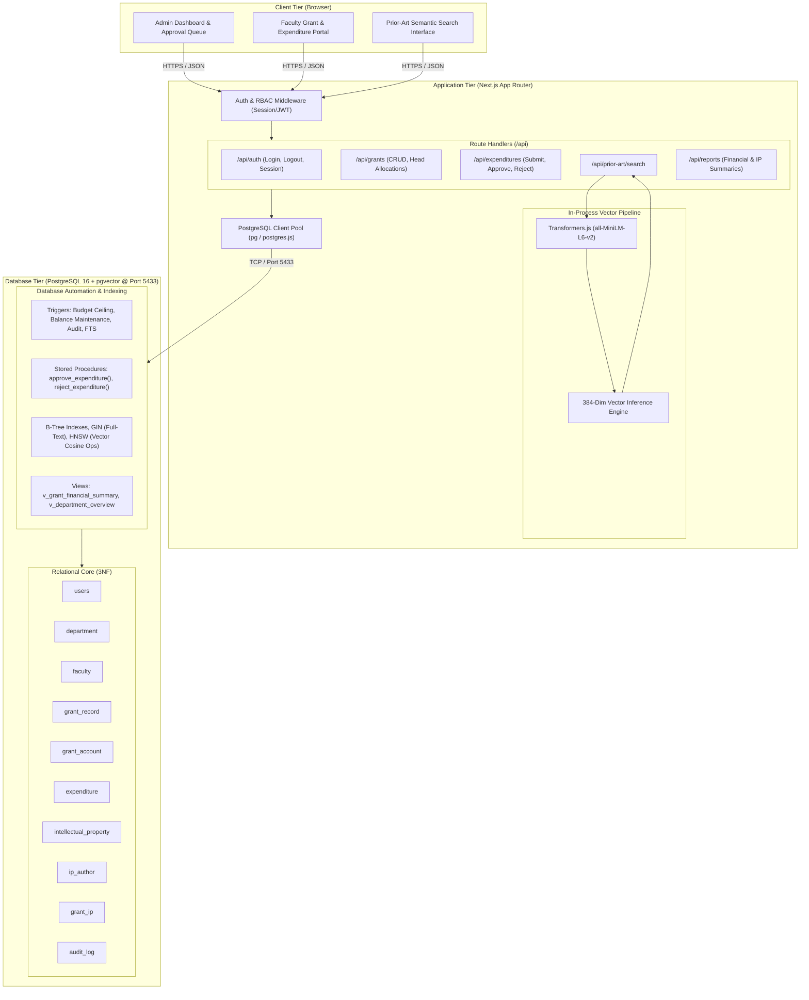

# System Architecture, Folder Structure, API & Test Specifications

## 1. System Architecture Overview

The system employs a 3-tier architecture integrating modern web technologies with PostgreSQL 16 and `pgvector`:
- **Presentation Tier**: Next.js 14+ (App Router) delivering server-side rendered pages and interactive client components.
- **Application & API Tier**: Next.js Route Handlers in TypeScript, handling authentication, role-based authorization guards, input validation, and local vector embeddings via Transformers.js.
- **Data & Vector Storage Tier**: Containerized PostgreSQL 16 on port 5433 with native `pgvector` and full-text search extensions.



---

## 2. Proposed Repository Directory Structure

```
Faculty-Research-Grant-Expenditure-Patent-Prior-Art-Engine/
├── .env.example                       # Committed template for runtime configuration
├── .gitignore                         # Comprehensive ignore list
├── docker-compose.yml                 # Docker service for PostgreSQL 16 + pgvector
├── package.json                       # Dependencies, scripts, and tooling config
├── tsconfig.json                      # Strict TypeScript compiler options
├── next.config.mjs                    # Next.js framework configuration
├── tailwind.config.ts                 # Styling design tokens
├── docs/
│   └── design/                        # System and database design specifications
│       ├── 01_objectives_and_requirements.md
│       ├── 02_er_diagram.md
│       ├── 03_relational_schema.md
│       ├── 04_data_dictionary.md
│       ├── 05_advanced_features.md
│       ├── 06_vector_design.md
│       └── 07_architecture.md
├── sql/
│   ├── migrations/                    # Sequential DDL and schema migrations
│   │   ├── 001_initial_schema.sql
│   │   ├── 002_triggers_and_procedures.sql
│   │   ├── 003_views_and_indexes.sql
│   │   └── 004_full_text_search.sql
│   └── seeds/
│       └── seed_data.sql              # Realistic university research dataset
├── src/
│   ├── app/                           # Next.js App Router pages and APIs
│   │   ├── api/                       # Backend Route Handlers
│   │   │   ├── auth/
│   │   │   │   ├── login/route.ts
│   │   │   │   ├── logout/route.ts
│   │   │   │   └── me/route.ts
│   │   │   ├── grants/
│   │   │   │   ├── route.ts
│   │   │   │   └── [id]/
│   │   │   │       ├── route.ts
│   │   │   │       └── accounts/route.ts
│   │   │   ├── expenditures/
│   │   │   │   ├── route.ts
│   │   │   │   └── [id]/
│   │   │   │       ├── approve/route.ts
│   │   │   │       └── reject/route.ts
│   │   │   ├── prior-art/
│   │   │   │   └── search/route.ts
│   │   │   └── reports/
│   │   │       ├── financial-summary/route.ts
│   │   │       └── department-overview/route.ts
│   │   ├── (auth)/                    # Authentication route groups
│   │   │   └── login/page.tsx
│   │   ├── (dashboard)/               # Protected application pages
│   │   │   ├── admin/
│   │   │   │   ├── grants/page.tsx
│   │   │   │   ├── approvals/page.tsx
│   │   │   │   └── reports/page.tsx
│   │   │   ├── faculty/
│   │   │   │   ├── grants/page.tsx
│   │   │   │   └── expenditures/page.tsx
│   │   │   └── prior-art/page.tsx
│   │   ├── layout.tsx
│   │   └── page.tsx                   # Landing page
│   ├── components/                    # Reusable React UI components
│   │   ├── ui/                        # Buttons, modals, tables, badges
│   │   ├── forms/                     # Expenditure, grant, and search forms
│   │   └── charts/                    # Spend and utilization visualizations
│   ├── lib/                           # Core utilities and business services
│   │   ├── db/
│   │   │   ├── client.ts              # PostgreSQL pooled connection client
│   │   │   └── queries.ts             # Centralized parameterized SQL queries
│   │   ├── auth/
│   │   │   ├── session.ts             # JWT signing and cookie management
│   │   │   └── passwords.ts           # Password hashing and verification
│   │   └── vector/
│   │       └── embedder.ts            # Local Transformers.js pipeline wrapper
│   └── types/                         # TypeScript domain interfaces
│       └── db.ts
└── tests/
    ├── db/                            # Vitest database constraint & trigger tests
    │   ├── constraints.test.ts
    │   ├── triggers.test.ts
    │   ├── transactions.test.ts
    │   └── queries.test.ts
    ├── api/                           # Vitest API route integration tests
    │   ├── auth.test.ts
    │   ├── expenditures.test.ts
    │   └── vector_search.test.ts
    └── e2e/                           # Playwright end-to-end browser tests
        ├── auth_flow.spec.ts
        ├── expenditure_workflow.spec.ts
        └── prior_art_search.spec.ts
```

---

## 3. API Endpoint Specification & Role Access Control

| Method | Endpoint Path | Allowed Roles | Description | Request Body / Parameters | Response Status & Payload |
|---|---|:---:|---|---|---|
| `POST` | `/api/auth/login` | Public | Authenticates user; issues HTTP-only session cookie. | `{ email, password }` | `200 OK` `{ user: { id, email, role } }` |
| `POST` | `/api/auth/logout` | Authenticated | Clears session cookie and invalidates session. | None | `200 OK` `{ success: true }` |
| `GET` | `/api/auth/me` | Authenticated | Returns current authenticated user profile and role. | None | `200 OK` `{ user: { ... } }` |
| `GET` | `/api/grants` | ADMIN, FACULTY | Lists grants. `ADMIN` sees all; `FACULTY` sees only grants where they are PI. | Query: `?status=ACTIVE` | `200 OK` `[ { grant_id, grant_code, title, ... } ]` |
| `POST` | `/api/grants` | ADMIN | Creates a new research grant record. | `{ grant_code, title, agency, pi_id, budget, start, end }` | `201 Created` `{ grant_id, ... }` |
| `GET` | `/api/grants/[id]` | ADMIN, FACULTY | Fetches grant details and line-item accounts. | Path: `id` | `200 OK` `{ grant: { ... }, accounts: [ ... ] }` |
| `POST` | `/api/grants/[id]/accounts` | ADMIN | Allocates budget head account under grant. | `{ category, budget_allocated }` | `201 Created` `{ account_id, ... }` |
| `GET` | `/api/expenditures` | ADMIN, FACULTY | Lists expenditures. `ADMIN` sees all university claims; `FACULTY` sees own. | Query: `?status=PENDING&grant_id=1` | `200 OK` `[ { transaction_id, amount, status, ... } ]` |
| `POST` | `/api/expenditures` | FACULTY | Submits a new expenditure claim against an account. | `{ account_id, amount, description, invoice_ref, date }` | `201 Created` `{ transaction_id, status: "PENDING" }` |
| `POST` | `/api/expenditures/[id]/approve` | ADMIN | Atomically approves claim and deducts balance. | None | `200 OK` `{ transaction_id, status: "APPROVED", remaining_balance }` |
| `POST` | `/api/expenditures/[id]/reject` | ADMIN | Rejects pending claim or reverts approved claim. | `{ reason }` | `200 OK` `{ transaction_id, status: "REJECTED" }` |
| `POST` | `/api/prior-art/search` | ADMIN, FACULTY | Embeds draft abstract text and returns ranked prior art. | `{ text, limit, doc_type, threshold }` | `200 OK` `[ { document_id, title, similarity_score, authors, grants } ]` |
| `GET` | `/api/reports/financial-summary` | ADMIN | Returns aggregated grant utilization view. | Query: `?agency=DST` | `200 OK` `[ { grant_code, sanctioned, spent, ... } ]` |
| `GET` | `/api/reports/department-overview` | ADMIN | Returns department-wide research spend metrics. | None | `200 OK` `[ { department_code, total_sanctioned, total_spent } ]` |

---

## 4. Test Strategy and Verification Case Suite

Our test strategy incorporates three distinct levels of verification:
1. **Database Constraint & Logic Tests** (direct SQL / Vitest)
2. **API & Authorization Tests** (Route Handlers / Vitest)
3. **End-to-End System Tests** (Playwright)

### 4.1 Database Constraint Tests (`tests/db/constraints.test.ts`)
- **TC-DB-01**: Negative grant budget rejection (`CHECK (total_budget > 0)`).
- **TC-DB-02**: Invalid grant dates rejection (`CHECK (end_date >= start_date)`).
- **TC-DB-03**: Duplicate category per grant rejection (`UNIQUE (grant_id, category)`).
- **TC-DB-04**: Account balance constraint rejection when `current_balance > budget_allocated` or `current_balance < 0`.
- **TC-DB-05**: Duplicate email rejection in `users` and `faculty` tables.
- **TC-DB-06**: Foreign key deletion rejection on `department` when referenced by `faculty` (`ON DELETE RESTRICT`).

### 4.2 Database Trigger & Automation Tests (`tests/db/triggers.test.ts`)
- **TC-TRG-01**: Allocation ceiling trigger rejects when `SUM(budget_allocated) > grant_record.total_budget`.
- **TC-TRG-02**: Submitting an expenditure against a `CLOSED` or `SUSPENDED` grant is rejected by the pre-validation trigger.
- **TC-TRG-03**: Submitting an expenditure with a transaction date outside the grant's active lifespan is rejected.
- **TC-TRG-04**: Non-PI faculty submitting expenditure against another faculty's grant is rejected.
- **TC-TRG-05**: Successful expenditure status update fires the audit trigger and generates a new record in `audit_log` with correct old and new state JSON.
- **TC-TRG-06**: Inserting an intellectual property disclosure auto-populates `tsv` with weighted title and abstract lexemes.

### 4.3 Transaction & Concurrency Tests (`tests/db/transactions.test.ts`)
- **TC-TX-01**: Atomic approval decreases `grant_account.current_balance` by exact expenditure amount.
- **TC-TX-02**: Attempting to approve an expenditure exceeding available `current_balance` raises an exception and cleanly rolls back the transaction.
- **TC-TX-03**: Concurrent approval race condition test: two concurrent approvals whose combined sum exceeds balance result in exactly one successful approval and one serialized rollback.
- **TC-TX-04**: Reverting an approved expenditure restores the exact deducted amount to `current_balance`.

### 4.4 Authentication & RBAC Tests (`tests/api/auth.test.ts`)
- **TC-AUTH-01**: Unauthenticated request to `/api/expenditures` returns HTTP `401 Unauthorized`.
- **TC-AUTH-02**: Faculty user attempting to approve an expenditure via `/api/expenditures/[id]/approve` returns HTTP `403 Forbidden`.
- **TC-AUTH-03**: Faculty user requesting `/api/grants` only receives grants where their `pi_faculty_id` matches their profile.
- **TC-AUTH-04**: Admin user requesting `/api/grants` receives all grants across all departments.

### 4.5 Vector Semantic Ranking Tests (`tests/api/vector_search.test.ts`)
- **TC-VEC-01**: Dense embedding generation produces an array of exactly 384 floating-point elements.
- **TC-VEC-02**: Semantic ranking test: A query on *"quantum cryptography key distribution"* ranks quantum photonics disclosures significantly higher than unrelated *"composite polymer synthesis"* disclosures.
- **TC-VEC-03**: Cosine distance calculation in SQL matches calculated dot product of normalized test vectors.
- **TC-VEC-04**: Relational metadata join returns authors, departments, and linked grant codes within the search response.

### 4.6 End-to-End User Flow Tests (`tests/e2e/workflow.spec.ts`)
- **E2E-01 (Admin Lifecycle)**: Admin logs in -> Creates Department -> Creates Faculty -> Provisions Grant -> Allocates Category Accounts -> Views Financial Summary.
- **E2E-02 (Faculty Expense Lifecycle)**: Faculty logs in -> Views allocated grant accounts -> Submits INR 45,000 Equipment expense -> Verifies status is `PENDING`.
- **E2E-03 (Approval & Audit Lifecycle)**: Admin opens approval dashboard -> Approves pending expense -> Verifies balance deducted -> Inspects Audit Log table.
- **E2E-04 (Prior-Art Clearance)**: Faculty pastes patent draft disclosure -> Clicks "Analyze Prior Art" -> Inspects top 3 similar institutional disclosures with similarity scores and author affiliations.
