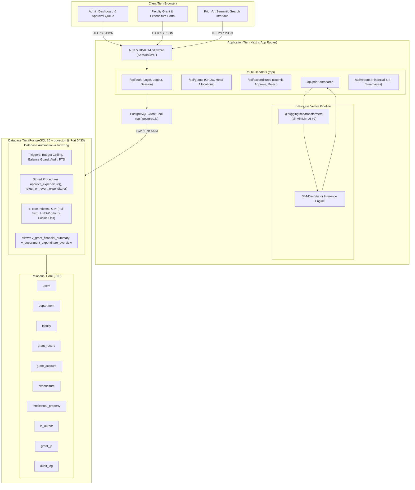

# System Architecture, Folder Structure, API & Test Specifications

## 1. System Architecture Overview

The system uses a 3-tier architecture integrating modern web technologies with PostgreSQL 16 and `pgvector`:
- **Presentation Tier**: Next.js 14+ (App Router) delivering server-side rendered pages and interactive client components.
- **Application & API Tier**: Next.js Route Handlers in TypeScript, handling authentication, role-based authorization guards, input validation, and local vector embeddings via `@huggingface/transformers`. The project uses the Node major version installed on the team machines (Node v26), pinned through `.nvmrc` and `package.json` engines (`>=22`).
- **Data & Vector Storage Tier**: Containerized PostgreSQL 16 on port 5433 using Docker image `pgvector/pgvector:0.8.0-pg16` with native `pgvector` and full-text search extensions. Connections from the API and test suites operate under a restricted database role `app_user` (granted `SELECT`/`INSERT`/`UPDATE`/`DELETE` on operational tables, `SELECT`/`INSERT` only on `audit_log`, and denied `TRUNCATE` and `TRIGGER` rights).



---

## 2. Repository Directory Structure

```
Faculty-Research-Grant-Expenditure-Patent-Prior-Art-Engine/
├── .env.example                       # Template for environment configuration
├── .gitignore                         # Git ignore configuration
├── docker-compose.yml                 # PostgreSQL 16 + pgvector service config
├── package.json                       # Project scripts and dependencies
├── tsconfig.json                      # TypeScript configuration
├── next.config.mjs                    # Next.js configuration
├── tailwind.config.ts                 # Tailwind styling config
├── docs/
│   └── design/                        # System and database design specifications
│       ├── 01_objectives_and_requirements.md
│       ├── 02_er_diagram.md
│       ├── 03_relational_schema.md
│       ├── 04_data_dictionary.md
│       ├── 05_advanced_features.md
│       ├── 06_vector_design.md
│       └── 07_architecture.md
├── sql/
│   ├── migrations/                    # Database DDL migration scripts
│   │   ├── 001_initial_schema.sql
│   │   ├── 002_triggers_and_procedures.sql
│   │   ├── 003_views_and_indexes.sql
│   │   └── 004_full_text_search.sql
│   └── seeds/
│       └── seed_data.sql              # University research seed dataset
├── src/
│   ├── app/                           # Next.js App Router pages and APIs
│   │   ├── api/                       # Backend Route Handlers
│   │   │   ├── auth/
│   │   │   │   ├── login/route.ts
│   │   │   │   ├── logout/route.ts
│   │   │   │   └── me/route.ts
│   │   │   ├── grants/
│   │   │   │   ├── route.ts
│   │   │   │   └── [id]/
│   │   │   │       ├── route.ts
│   │   │   │       └── accounts/route.ts
│   │   │   ├── expenditures/
│   │   │   │   ├── route.ts
│   │   │   │   └── [id]/
│   │   │   │       ├── approve/route.ts
│   │   │   │       └── reject/route.ts
│   │   │   ├── prior-art/
│   │   │   │   └── search/route.ts
│   │   │   └── reports/
│   │   │       ├── financial-summary/route.ts
│   │   │       └── department-overview/route.ts
│   │   ├── (auth)/                    # Login route group
│   │   │   └── login/page.tsx
│   │   ├── (dashboard)/               # Role-protected pages
│   │   │   ├── admin/
│   │   │   │   ├── grants/page.tsx
│   │   │   │   ├── approvals/page.tsx
│   │   │   │   └── reports/page.tsx
│   │   │   ├── faculty/
│   │   │   │   ├── grants/page.tsx
│   │   │   │   └── expenditures/page.tsx
│   │   │   └── prior-art/page.tsx
│   │   ├── layout.tsx
│   │   └── page.tsx                   # Landing page
│   ├── components/                    # React UI components
│   │   ├── ui/                        # Buttons, modals, tables, badges
│   │   ├── forms/                     # Form components
│   │   └── charts/                    # Spending visualizations
│   ├── lib/                           # Core utilities
│   │   ├── db/
│   │   │   ├── client.ts              # PostgreSQL pooled client
│   │   │   └── queries.ts             # Parameterized SQL queries
│   │   ├── auth/
│   │   │   ├── session.ts             # Session / JWT helpers
│   │   │   └── passwords.ts           # Password hashing
│   │   └── vector/
│   │       └── embedder.ts            # @huggingface/transformers wrapper
│   └── types/                         # TypeScript interfaces
│       └── db.ts
└── tests/
    ├── db/                            # Vitest database constraint & trigger tests
    │   ├── constraints.test.ts
    │   ├── triggers.test.ts
    │   ├── transactions.test.ts
    │   └── queries.test.ts
    ├── api/                           # Vitest API route integration tests
    │   ├── auth.test.ts
    │   ├── expenditures.test.ts
    │   └── vector_search.test.ts
    └── e2e/                           # Playwright end-to-end browser tests
        ├── auth_flow.spec.ts
        ├── expenditure_workflow.spec.ts
        └── prior_art_search.spec.ts
```

---

## 3. API Endpoint Specification & Role Access Control

| Method | Endpoint Path | Allowed Roles | Description | Request Body / Parameters | Response Status & Payload |
|---|---|:---:|---|---|---|
| `POST` | `/api/auth/login` | Public | Authenticates user; issues HTTP-only session cookie. | `{ email, password }` | `200 OK` `{ user: { id, email, role } }` |
| `POST` | `/api/auth/logout` | Authenticated | Clears session cookie and invalidates session. | None | `200 OK` `{ success: true }` |
| `GET` | `/api/auth/me` | Authenticated | Returns current authenticated user profile and role. | None | `200 OK` `{ user: { ... } }` |
| `GET` | `/api/grants` | ADMIN, FACULTY | Lists grants. `ADMIN` sees all; `FACULTY` sees only grants where they are PI. | Query: `?status=ACTIVE` | `200 OK` `[ { grant_id, grant_code, title, ... } ]` |
| `POST` | `/api/grants` | ADMIN | Creates a new research grant record. | `{ grant_code, title, agency, pi_id, budget, start, end }` | `201 Created` `{ grant_id, ... }` |
| `GET` | `/api/grants/[id]` | ADMIN, FACULTY | Fetches grant details and line-item accounts. | Path: `id` | `200 OK` `{ grant: { ... }, accounts: [ ... ] }` |
| `POST` | `/api/grants/[id]/accounts` | ADMIN | Allocates budget head account under grant. | `{ category, budget_allocated }` | `201 Created` `{ account_id, ... }` |
| `GET` | `/api/expenditures` | ADMIN, FACULTY | Lists expenditures. `ADMIN` sees all claims; `FACULTY` sees own. | Query: `?status=PENDING&grant_id=1` | `200 OK` `[ { transaction_id, amount, status, ... } ]` |
| `POST` | `/api/expenditures` | FACULTY | Submits a new expenditure claim against an account. | `{ account_id, amount, description, invoice_ref, date }` | `201 Created` `{ transaction_id, status: "PENDING" }` |
| `POST` | `/api/expenditures/[id]/approve` | ADMIN | Calls `approve_expenditure()` to approve claim. | None | `200 OK` `{ transaction_id, status: "APPROVED", remaining_balance }` |
| `POST` | `/api/expenditures/[id]/reject` | ADMIN | Calls `reject_or_revert_expenditure()` to reject/revert claim. | `{ reason }` | `200 OK` `{ transaction_id, status: "REJECTED" }` |
| `POST` | `/api/prior-art/search` | ADMIN, FACULTY | Embeds draft text and returns ranked prior art. | `{ text, limit, doc_type }` | `200 OK` `[ { document_id, title, similarity_score, authors, grants } ]` |
| `GET` | `/api/reports/financial-summary` | ADMIN | Returns aggregated grant utilization view. | Query: `?agency=DST` | `200 OK` `[ { grant_code, sanctioned, spent, ... } ]` |
| `GET` | `/api/reports/department-overview` | ADMIN | Returns department-level spend overview. | None | `200 OK` `[ { department_code, total_sanctioned, total_spent } ]` |

---

## 4. Test Strategy and Verification Case Suite

Our test strategy incorporates three distinct levels of verification:
1. **Database Constraint & Logic Tests** (Vitest running direct SQL against PostgreSQL on port 5433)
2. **API & Authorization Tests** (Vitest testing Route Handlers and middleware)
3. **End-to-End System Tests** (Playwright testing full browser flows)

### 4.1 Database Constraint Tests (`tests/db/constraints.test.ts`)
- **TC-DB-01**: Negative grant budget rejection (`CHECK (total_budget > 0)`).
- **TC-DB-02**: Invalid grant dates rejection (`CHECK (end_date >= start_date)`).
- **TC-DB-03**: Duplicate category per grant rejection (`UNIQUE (grant_id, category)`).
- **TC-DB-04**: Account balance constraint rejection when `current_balance > budget_allocated` or `current_balance < 0`.
- **TC-DB-05**: Duplicate email rejection in `users` and `faculty` tables.
- **TC-DB-06**: Foreign key deletion rejection on `department` when referenced by `faculty` (`ON DELETE RESTRICT`).
- **TC-DB-07**: Foreign key deletion rejection on `faculty` when referenced by `users` (`ON DELETE RESTRICT`).
- **TC-DB-08**: State constraint validation on `expenditure`:
  - `PENDING` with non-null `approved_by` or `decision_date` is rejected.
  - `APPROVED` with null `approved_by` or null `decision_date` is rejected.
  - `REJECTED` with null `decision_date` or null `rejection_reason` is rejected.

### 4.2 Database Trigger & Integrity Tests (`tests/db/triggers.test.ts`)
- **TC-TRG-01 (Budget Ceiling)**: Allocation ceiling trigger rejects when `SUM(budget_allocated) > grant_record.total_budget`.
- **TC-TRG-02 (Budget Reduction Guard)**: Reducing `grant_record.total_budget` below the sum of allocated accounts is rejected.
- **TC-TRG-03 (Direct Balance Update Guard)**: Direct `UPDATE grant_account SET current_balance = ...` from an application query is rejected.
- **TC-TRG-04 (Account Insert Balance Initialization)**: Inserting a `grant_account` with an arbitrary `current_balance` ignores that value and sets `current_balance = budget_allocated`.
- **TC-TRG-05 (Allocation Shift Balance Adjustment)**: Updating `budget_allocated` on a `grant_account` adjusts `current_balance` by the exact delta, and raises an error if the balance would drop below zero.
- **TC-TRG-06 (Immutable Account ID & Grant ID)**:
  - Attempting to `UPDATE expenditure SET account_id = ...` is rejected.
  - Attempting to `UPDATE expenditure SET submitted_by = ...` is rejected.
  - Attempting to `UPDATE grant_account SET grant_id = ...` is rejected.
- **TC-TRG-07 (Amount Edit in Pending Only)**: Attempting to `UPDATE expenditure SET amount = ...` on an `APPROVED` or `REJECTED` expenditure is rejected.
- **TC-TRG-08 (Decided Rows Frozen)**: Attempting to modify `description`, `approved_by`, `decision_date`, or `rejection_reason` on an already decided row (`APPROVED` or `REJECTED`) without changing status is rejected.
- **TC-TRG-09 (Illegal Status Transitions & Approver Role)**:
  - `INSERT` of an expenditure with status `APPROVED` or non-null approval fields is rejected.
  - Transitioning an expenditure to `APPROVED` or `REJECTED` with a non-`ADMIN` `approved_by` user ID is rejected.
  - `REJECTED -> APPROVED` is rejected.
  - `REJECTED -> PENDING` is rejected.
  - `APPROVED -> PENDING` is rejected.
  - Approving an already `APPROVED` expenditure via `approve_expenditure()` is rejected.
  - Rejecting an already `REJECTED` expenditure via `reject_or_revert_expenditure()` is rejected.
- **TC-TRG-10 (Direct Status Update Maintains Balance)**: Running a direct `UPDATE expenditure SET status = 'APPROVED', approved_by = 1, decision_date = NOW() WHERE transaction_id = ...` deducts the balance from `grant_account` through the AFTER UPDATE trigger.
- **TC-TRG-11 (Reversion Restores Balance)**: Transitioning an expenditure from `APPROVED` to `REJECTED` restores the exact amount to `grant_account.current_balance`.
- **TC-TRG-12 (Inactive Grant Submissions)**: Submitting an expenditure against a `CLOSED` or `SUSPENDED` grant is rejected.
- **TC-TRG-13 (Date Lifespan Validation)**: Submitting an expenditure outside the grant active dates is rejected.
- **TC-TRG-14 (Non-PI Submission)**: Non-PI faculty submitting expenditure against another faculty's grant is rejected.
- **TC-TRG-15 (Audit Log Immutability)**:
  - Any `UPDATE` statement against `audit_log` is rejected with an exception.
  - Any `DELETE` statement against `audit_log` is rejected with an exception.
  - Any `TRUNCATE audit_log` statement is rejected with an exception.
- **TC-TRG-16 (Audit Log Submission Tracking)**: Inserting an expenditure creates a `CREATED` audit entry with the submitting faculty's user ID recorded in `changed_by`.
- **TC-TRG-17 (FTS Synchronization)**: Inserting an intellectual property disclosure auto-populates `tsv` with weighted title and abstract lexemes.
- **TC-TRG-18 (App User Role Execution)**: All database integrity tests are also verified when executing under the limited `app_user` database role.

### 4.3 Transaction & Concurrency Tests (`tests/db/transactions.test.ts`)
- **TC-TX-01**: Atomic approval decreases `grant_account.current_balance` by the exact expenditure amount.
- **TC-TX-02**: Attempting to approve an expenditure exceeding available `current_balance` raises an exception and cleanly rolls back the transaction.
- **TC-TX-03 (Concurrent Overdraw Protection)**: Two concurrent approvals on the same account whose combined sum exceeds the available balance result in exactly one approval succeeding and one being cleanly rejected.
- **TC-TX-04 (Concurrent Account Allocations)**: Two concurrent `INSERT` operations into `grant_account` under the same grant whose combined budget exceeds `total_budget` result in one transaction succeeding and one being rejected due to the `SELECT ... FOR UPDATE` lock on the grant.
- **TC-TX-05**: Reverting an approved expenditure restores the exact deducted amount to `current_balance`.

### 4.4 Authentication & RBAC Tests (`tests/api/auth.test.ts`)
- **TC-AUTH-01**: Unauthenticated request to `/api/expenditures` returns HTTP `401 Unauthorized`.
- **TC-AUTH-02**: Faculty user attempting to approve an expenditure via `/api/expenditures/[id]/approve` returns HTTP `403 Forbidden`.
- **TC-AUTH-03**: Faculty user requesting `/api/grants` only receives grants where their `pi_faculty_id` matches their profile.
- **TC-AUTH-04**: Admin user requesting `/api/grants` receives all grants across all departments.

### 4.5 Vector Semantic Ranking Tests (`tests/api/vector_search.test.ts`)
- **TC-VEC-01**: Embedding generation produces an array of exactly 384 numbers.
- **TC-VEC-02**: Semantic ranking test: A query on *"quantum cryptography key distribution"* ranks quantum physics disclosures higher than unrelated *"composite polymer synthesis"* disclosures.
- **TC-VEC-03**: Cosine distance in SQL matches calculated dot product of normalized test vectors.
- **TC-VEC-04**: Relational metadata join returns co-authors, departments, and linked grant codes in the search response.
- **TC-VEC-05**: Hybrid search query returns documents matching either semantic meaning or keyword lexemes.

### 4.6 End-to-End User Flow Tests (`tests/e2e/workflow.spec.ts`)
- **E2E-01 (Admin Lifecycle)**: Admin logs in -> Creates Department -> Creates Faculty -> Creates Grant -> Allocates Category Accounts -> Views Financial Summary.
- **E2E-02 (Faculty Expense Lifecycle)**: Faculty logs in -> Views allocated grant accounts -> Submits INR 45,000 Equipment expense -> Verifies status is `PENDING`.
- **E2E-03 (Approval & Audit Lifecycle)**: Admin opens approval dashboard -> Approves pending expense -> Verifies balance deducted -> Inspects Audit Log table.
- **E2E-04 (Prior-Art Clearance)**: Faculty pastes patent draft disclosure -> Clicks "Analyze Prior Art" -> Inspects top similar institutional disclosures with similarity scores and author affiliations.

### 4.7 Note on Test Data and Seed Seeding Strategy
Because the submission trigger (`fn_validate_expenditure_submission`) strictly forces all newly created expenditures to have `status = 'PENDING'` with NULL approval fields, test suites and database seed scripts cannot directly insert rows with `APPROVED` or `REJECTED` status. Instead, seeded or test expenditures that represent decided states must be inserted as `PENDING` and then transitioned programmatically through the sanctioned routines (`approve_expenditure` or `reject_or_revert_expenditure`), ensuring that balance deductions, restorations, and audit logs are triggered authentically.
